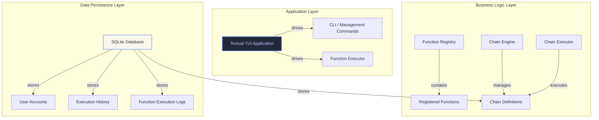

# Architecture

## Overview

HOJJAT TUI is a Python-based terminal user interface application built with the [Textual](https://textual.textualize.io/) framework. The system follows a modular architecture with clear separation of concerns between the UI layer, business logic, and data persistence.

## Component Diagram



## Core Modules

### `src/hojjat_tui/function.py`

- **Purpose**: Function registration decorator and global registry management.
- **Key APIs**: `@hojjat_function` decorator, `get_registry()`, `clear_logger()`
- **Mechanism**: When a function is decorated with `@hojjat_function`, its metadata (name, label, description, annotations, defaults, required parameters) is stored in a global `_REGISTRY` dictionary. The decorator also stores a `_hojjat_metadata` attribute on the decorated function.

### `src/hojjat_tui/executor.py`

- **Purpose**: Centralized function execution with output type detection and execution logging.
- **Key APIs**: `execute_function(name, kwargs)`, `_detect_output_type(output)`, `_log_execution(name, result)`
- **Mechanism**: Looks up the function in `_REGISTRY`, calls it with the given keyword arguments, detects the output type (text, markdown, json, table), logs the execution, and returns a `FunctionResult` dataclass.

### `src/hojjat_tui/chain.py`

- **Purpose**: Chain Engine — persistent function chaining framework.
- **Key APIs**: `create_chain()`, `add_step()`, `literal()`, `user_input()`, `output_of()`, `validate_chain()`, `execute_chain()`, `save_chain()`, `load_chain()`, `list_chains()`, `delete_chain()`
- **Mechanism**: Implements Pydantic data models for `Chain`, `ChainStep`, `ParameterBinding`, and `ChainExecution`. Supports three binding types: `LITERAL`, `USER_INPUT`, and `PREVIOUS_STEP`. Chains are persisted in the SQLite database via the persistence layer.

### `src/hojjat_tui/renderer.py`

- **Purpose**: Centralized output renderer for various output types.
- **Key APIs**: `render_output(output, output_type, title, console)`, `_render_table(data, title)`, `_render_chart_placeholder(data, title, console)`
- **Mechanism**: Uses [Rich](https://rich.textualize.io/) to render output in various formats. Supports text, markdown, JSON, tables, error/info panels, and a placeholder chart renderer (Phase 2 feature). Tables are rendered based on list-of-dicts or list-of-lists formats.

### `src/hojjat_tui/persistence.py`

- **Purpose**: SQLite-based storage for metadata, user accounts, and chain definitions.
- **Key APIs**: `Database` class, `hash_password()`, `verify_password()`, `save_chain()`, `load_chain()`, `list_chains()`, `clear_all_data()`, `get_default_db_path()`
- **Mechanism**: Provides a SQLite database wrapper with automatic table initialization. Stores user accounts with bcrypt-hashed passwords, function execution logs, chain definitions, chain steps, parameter bindings, and execution history. Database schema versioning is tracked in the `schema_meta` table.

### `src/hojjat_tui/tui.py`

- **Purpose**: Textual-based interactive TUI application.
- **Key Features**: Function menu navigation, chain builder wizard, function execution forms, result display with table/chart rendering, persistent chain management.
- **Mechanism**: A `textual.app.App` subclass that composes screens for function selection, chain building, chain execution, and result viewing. Uses Rich integration for output rendering.

### `src/hojjat_tui/builtin_functions.py`

- **Purpose**: Built-in sample functions demonstrating the registration API.
- **Included Functions**: `hello`, `time_info`, `factorial`, `random_quote`, `ping_test`, `system_info`, `error_demo`
- **Mechanism**: These functions are registered automatically when the module is imported via the `@hojjat_function` decorator. They serve as ready-to-use examples for testing the TUI and chain functionality.

### `src/hojjat_tui/management.py`

- **Purpose**: Django-style management commands for project administration.
- **Key Commands**: `init`, `createsuperuser`, `run`, `check`, `test`, `--version`
- **Mechanism**: An argparse-based command-line interface that provides administrative functions for database initialization, user management, function execution, project checking, and testing.

### `src/hojjat_tui/cli.py`

- **Purpose**: Console script entry point for the `hojjat-tui` command.
- **Key Features**: Starts the TUI when no arguments are provided, delegates to management commands when arguments are given, version display.
- **Mechanism**: The `main()` function checks `sys.argv` and either starts the TUI or delegates to the management command dispatcher.

## Data Flow

### Function Execution Flow

1. User selects a function from the TUI menu or runs via CLI
2. The TUI gathers parameter values from the user (via form inputs or parameter bindings)
3. `execute_function(name, kwargs)` is called
4. The function is looked up in the global registry and executed
5. Output type is detected and a `FunctionResult` is returned
6. The result is rendered by the renderer (text, table, markdown, etc.)
7. Execution is logged to the SQLite database

### Chain Execution Flow

1. User selects a saved chain from the TUI chains menu
2. `load_chain(name)` retrieves the chain definition from the database
3. `execute_chain(chain)` runs each step sequentially
4. Parameter bindings are resolved:
   - LITERAL values are used directly
   - USER_INPUT prompts the user at runtime
   - PREVIOUS_STEP retrieves output from a previous step
5. Each step's function is executed via `execute_function()`
6. Step results are collected and the overall chain status is determined
7. Execution history is saved to the SQLite database
8. Results are displayed in the TUI with appropriate rendering

### Chain Building Flow

1. User initiates chain creation from the TUI
2. The chain builder screen is displayed with function selector
3. User adds steps by selecting functions from the registry
4. For each step, user configures parameter bindings (literal, user input, previous step)
5. User saves the chain with a unique name
6. The chain definition is persisted via `save_chain()` to the SQLite database
7. The chain is immediately available for execution from the chains menu

## Extensibility

### Adding New Functions

To add a new function:

```python
from hojjat_tui.function import hojjat_function

@hojjat_function(
    name="my_new_function",
    label="My New Function",
    description="Does something useful",
    annotations={"input_param": {"type": "str", "description": "Input parameter"}},
    defaults={"input_param": ""},
    required=["input_param"],
)
def my_new_function(input_param: str = "") -> dict:
    return {"processed": input_param.upper()}
```

The function will be automatically registered in the global registry and available in the TUI.

### Adding New Chart Rendering

Phase 2 will introduce full chart rendering. To add chart support, extend the `render_output()` function in `renderer.py` with a new `output_type` case and implement the chart rendering logic.

### Custom Database Backends

The persistence layer is designed to be swap-compatible. To use a different database backend, implement the same interface as the `Database` class in `persistence.py` (initialization, chain save/load/list/delete, user management).